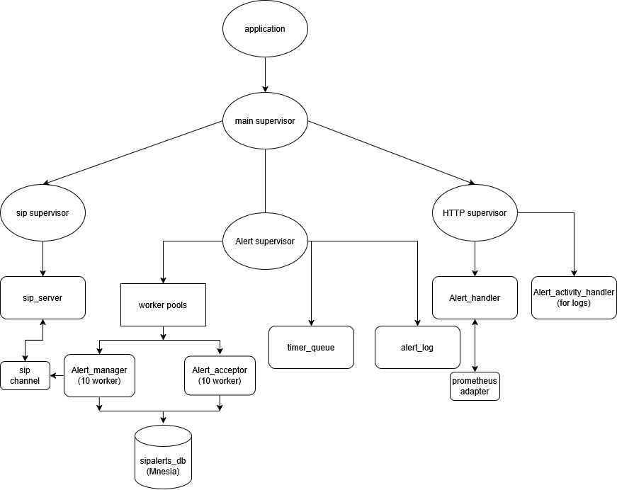
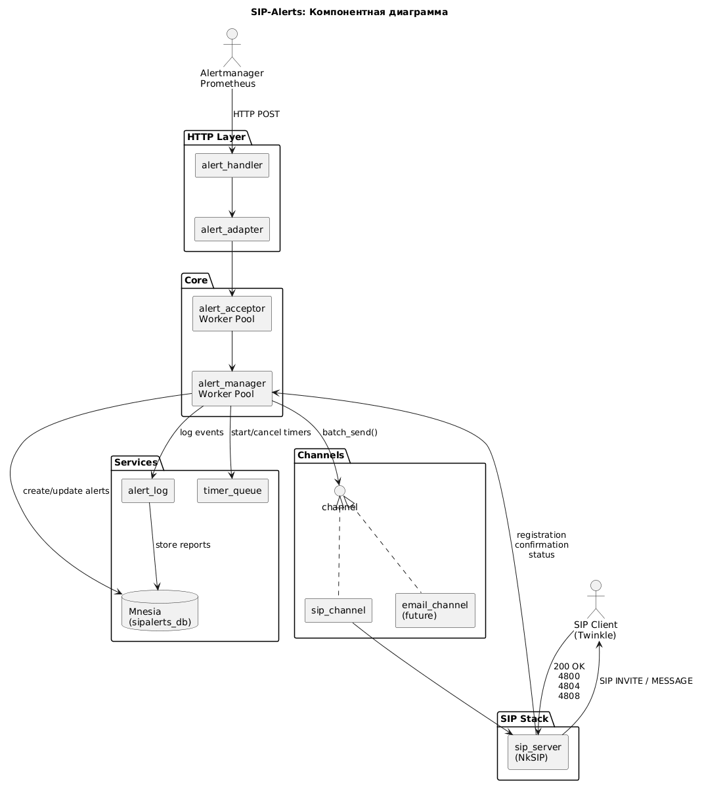
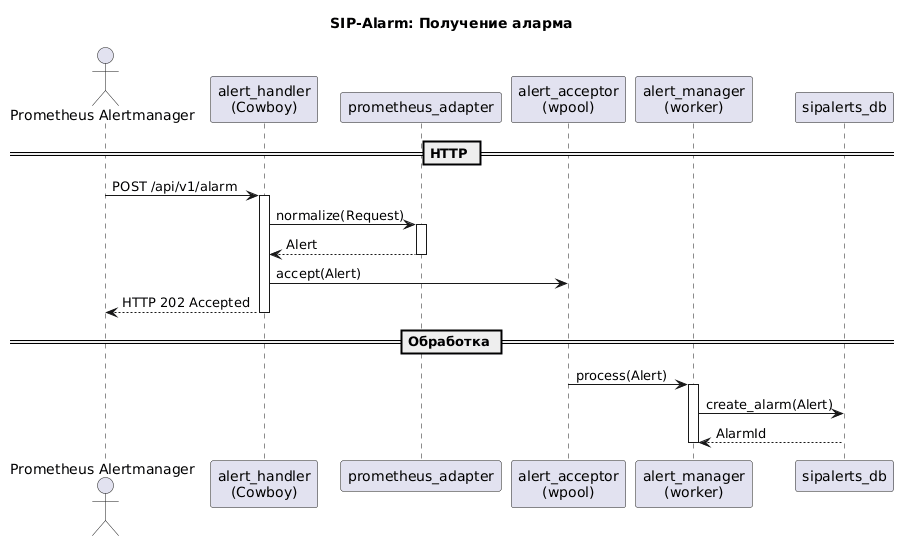
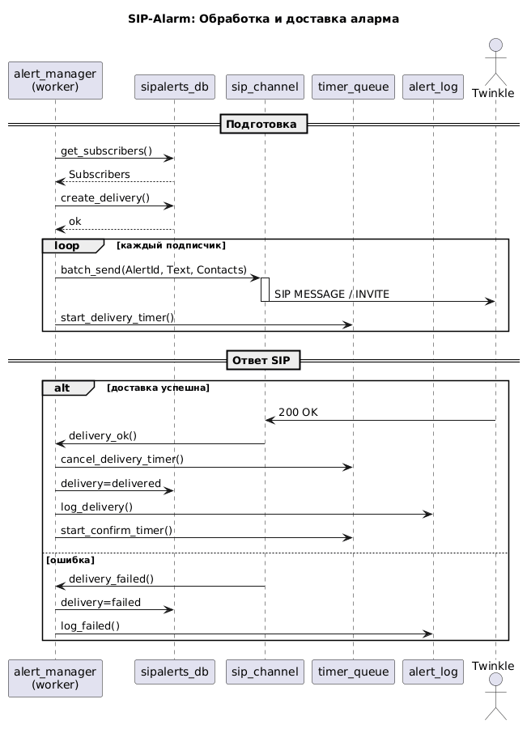
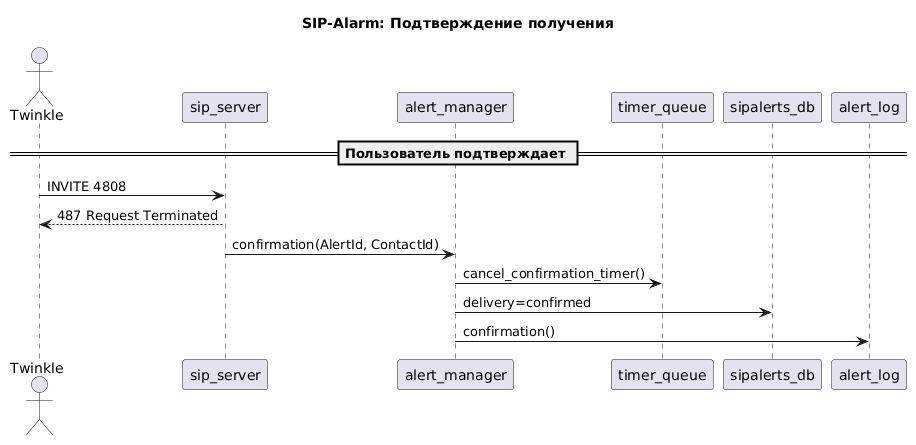
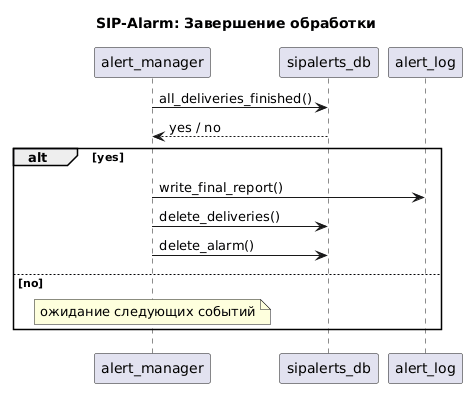
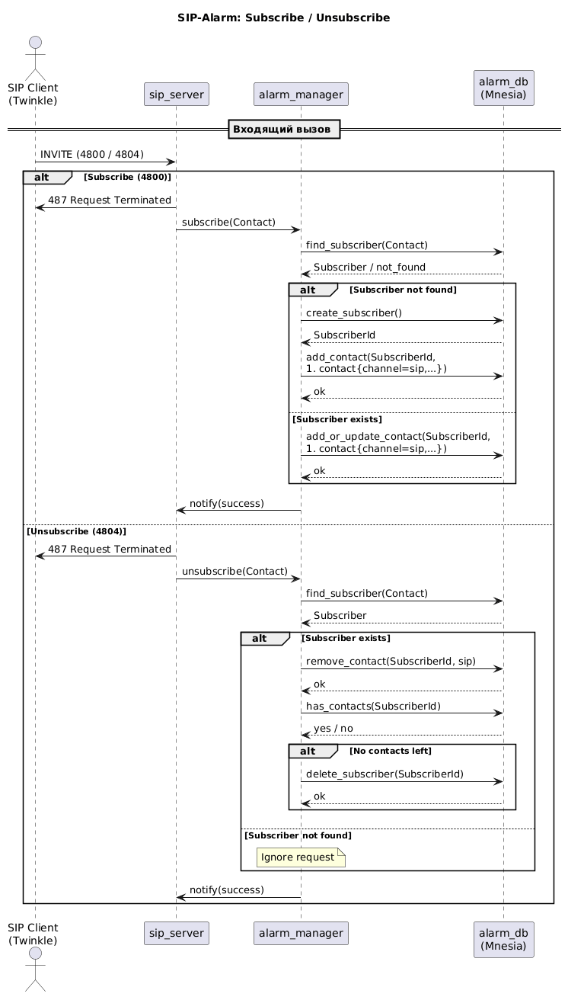

# SIP alerts

## Запуск
```
./tools/start_app.sh
```
Откроется eshell с запущенным приложением.

Текущий список SIP-абонентов находится в файле
```./priv/users.json```

Для SIP-абонентов операции - звонок на следующие номера:
1. ```4800``` - подписаться на уведомления
2. ```4804``` - отписаться от уведомлений
3. ```4808, Subject = AlertId``` - подтвердить получение алерта с соответствующим ID

Текущий статус уведомления отображается в логах работающего приложения.

Логи можно получить через HTTP GET отсюда: http://localhost:8080/log/alert_activity/

## Настройка development environment

> Подразумевается, что Docker установлен по [инструкции с официального сайта](https://docs.docker.com/engine/install). Корректная работа других версий (из snap, например) не гарантируется 

1. Открыть в VS Code папку проекта
2. Открыть Command Palette (F1), выбрать **Dev Containers: Reopen in Container**
> После интеграции mnesia, нужно запукать приложение через скрипт в папке tools + командой rebar3 shell -name sipalerts@127.0.0.1
3. Для проверки работы Prometheus и AlertManager в браузере откройте localhost по портам 9090 и 9093
4. Для проверки отсылки тестового алерта отправьте GET на http://localhost:9191/\_\_last_request\_\_
5. Для проверки дерева супервизоров можете воспользоваться eunit и вручную с помощью dummy_server:crash(Название модуля/супервизора).
6. Для проверки http-api можно запустить через rebar3 shell (смотреть вывод в терминал) либо запустить тесты соот. модулей
7. В конфигурацию проекта добавлен dialyzer:
    * первый раз нужно вручную выполнить rebar3 dialyzer, чтобы построить PLT (занимает некоторое время)
    * в выводе dialyzer могут быть ошибки от используемых модулей, но при работе над проектом они не помешают
    * далее erlang_ls будет автоматически анализировать открытые файлы и выводить ошибки dialyzer в problems
8. Рекомендую поставить в VS Code расширение [Error Lens](https://marketplace.visualstudio.com/items?itemName=usernamehw.errorlens) для удобного вывода ошибок прямо в проблемные строки
9. Для тестирования БД нужно использовать скрипт из папки tools + rebar3 eunit
10. Profit!


## Общие критерии

1. Возможно получится комбинировать задания и реализовывать единую систему, где курсанты реализуют каждый свой блок, в рамках единого контракта
2. Должна быть представлена работа в git-е
3. Все настройки, абоненты хранятся в БД на ваш выбор;
4. Настройки, и оперативные данные должны быть применены при рестарте приложения
5. Возможность распределенной работы двумя нодами (одновременно или мастер/слэйв)
6. Резервирование промежуточных состояний для возможности продолжения обслуживания после рестарта приложения 

## Задача

Интеграция с какой-нибудь системой алармов (например Prometheus Alertmanager).
1. Можно позвонить на какой-то номер, тем самым подписаться на алармы.
2. Фактически это SIP уведомления:
    * В системе формируем список номеров, участвующих в рассылке. Часть этих абонентов в системе зарегистрирована, часть нет, часть зарегистрированных - недоступна (регистрируем и киляем, чтобы не было штатной разрегистрации)
    * В С есть интерфейс входящих событий с текстом , например REST API
    * Получив событие , С делает попытки отправить SIP MESSAGE/совершить вызов (в display name будет текст аларма) всем номерам из списка 
    * При проходе списка должен сохраняться результат: каким номерам (и/или сколько их) сообщение было:
    * доставлено (абонент прислал в ответ 200)
    * не доставлено, с указанием причины:
    * не зарегистрирован, т.е. контакта регистрации нет
    * не доступен - сообщение отправлено, но не получен ответ 200
    * Отчет должен быть или выдан по запросу или(и) сохранен в файл (с указанием даты, времени и текста отправленного сообщения) ), но с реализацией стороны интеграции, которая генерирует уведомления)
3. В отличие от SIP уведомлений, подтверждением приема сообщения в отчете должен быть не ответ 200 на SIP MESSAGE, а встречный звонок на некоторый внутренний номер, например "4808". Получив такой вызов С отмечает сообщение (аларм) полученным реальным человеком, отбивает вызов ответом 487 и отмечает сообщение доставленным

## Модули, требуемые для реализации

* alert_handler - принимает HTTP API (POST), декодирование json, вызов внутреннего API (принимает webhook от Prometheus)
* sipalerts_manager - ядро приложение, отвечающий за жизненный цикл алармов и за взаимодействие остальными модулями
* sipalerts_db - модуль отвечающий за работу c бд
* prometheus_adapter - реализует normalize (из json http api post’a в наш формат)
* timer_queue - модуль отвечающий за таймеры для alert
* sip-server - модуль для поддержки sip-сервера
* sipalerts_log - модуль для хранения истории доставки и генерация отчетов (по запросу либо сохранятся в файле, можно сделать получение логов либо через запрос <GET> http api, либо как то автоматически)

## Дерево супервизоров



## Диаграмма компонентов



## sequence diagram (for alert)









## sequence diagram (for sub)

